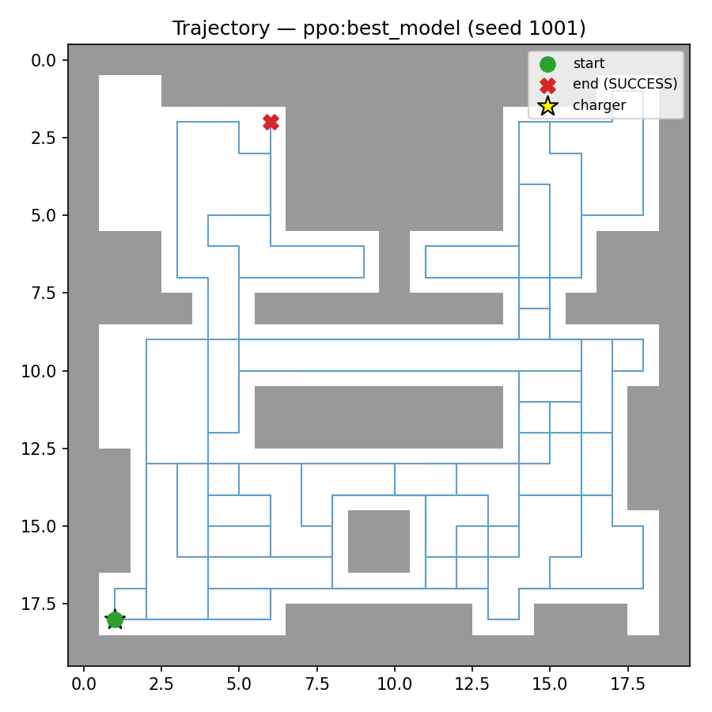
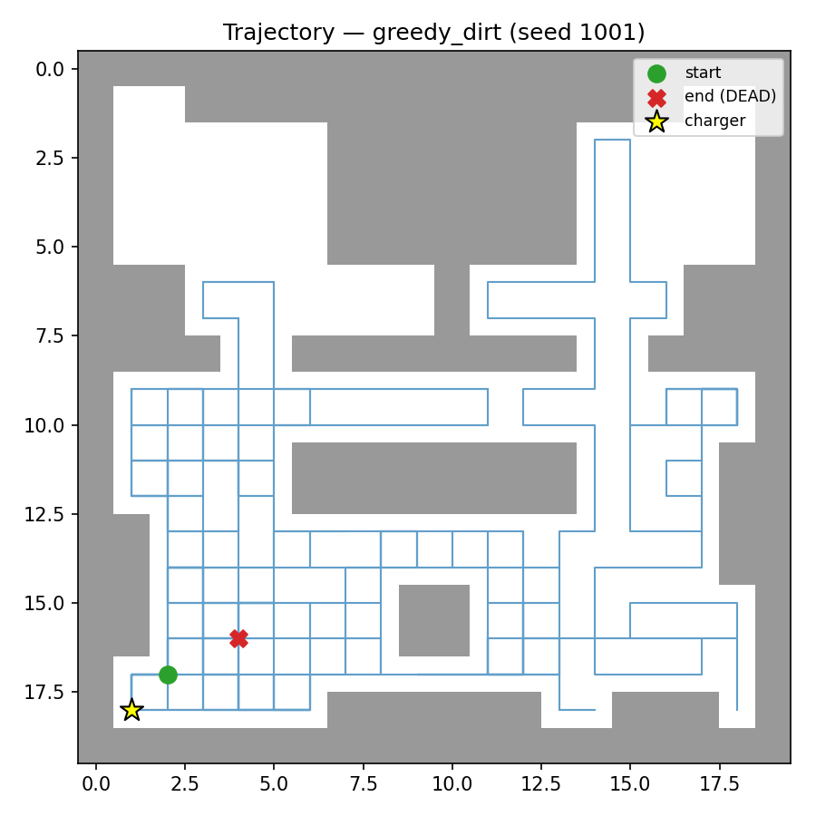
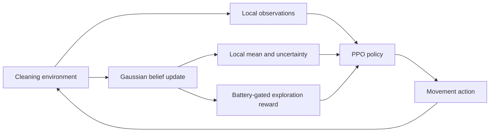
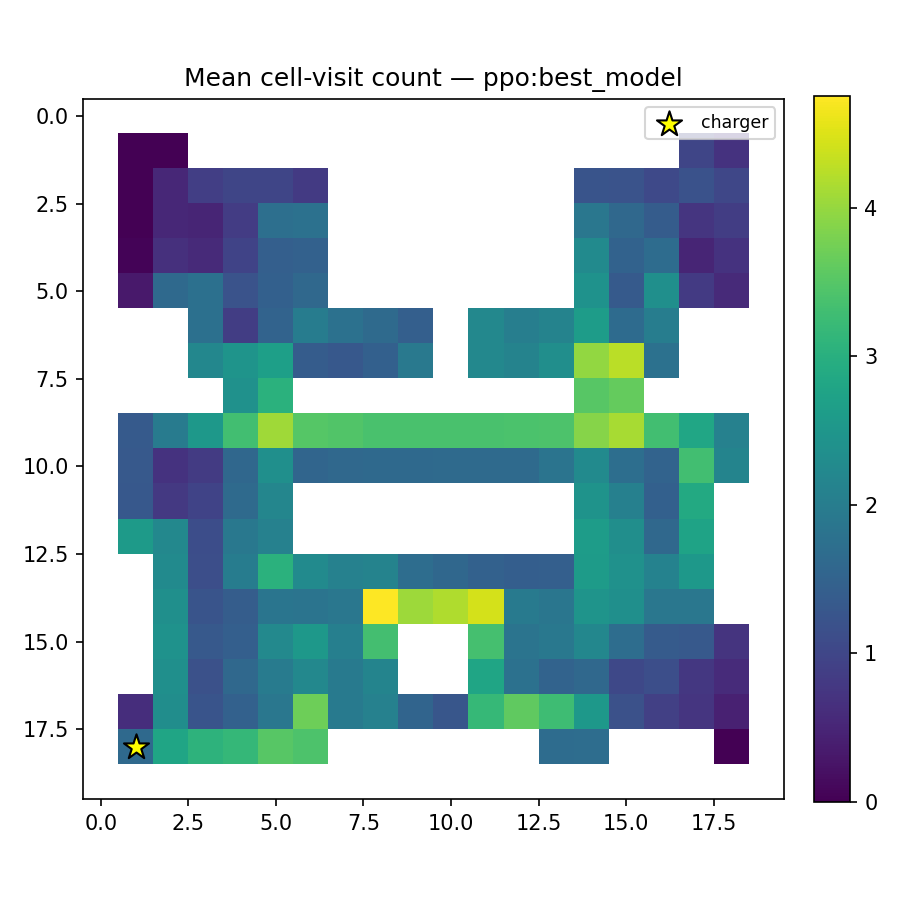
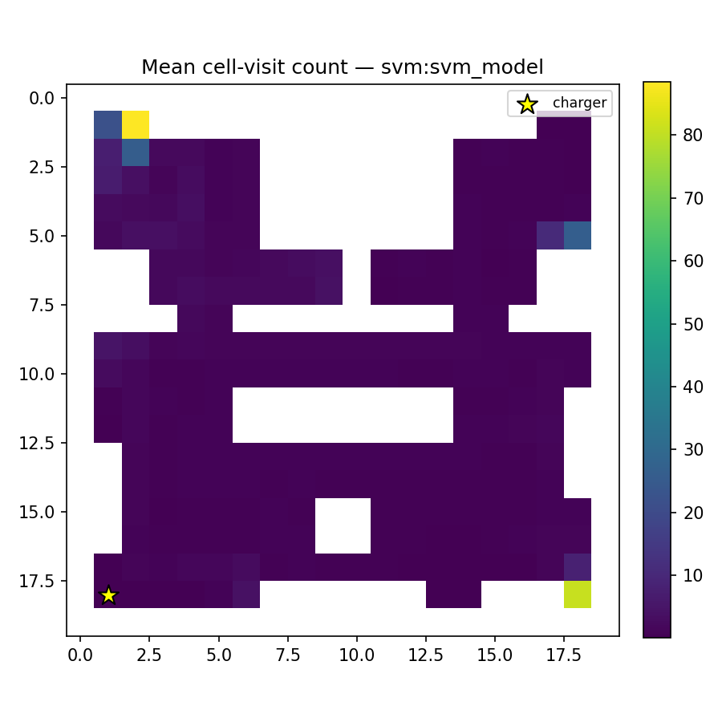
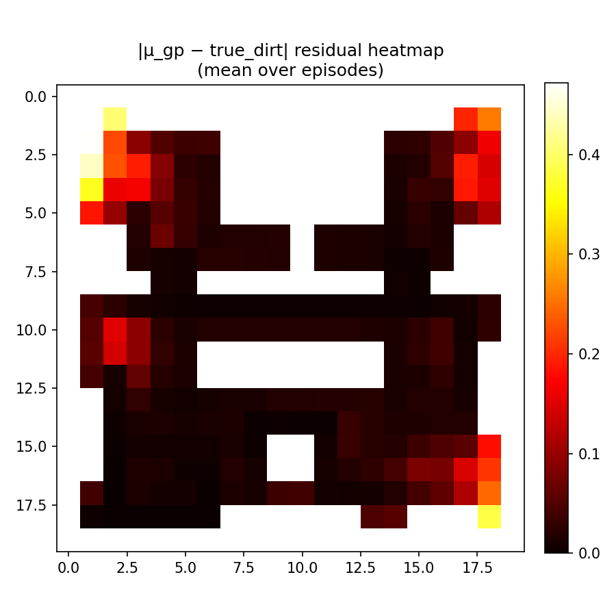
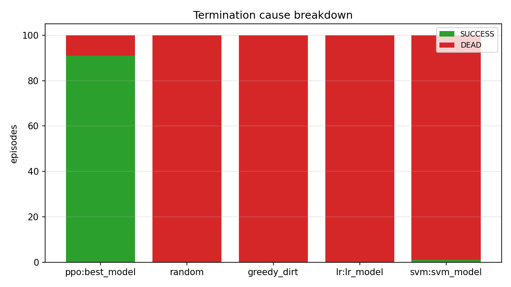
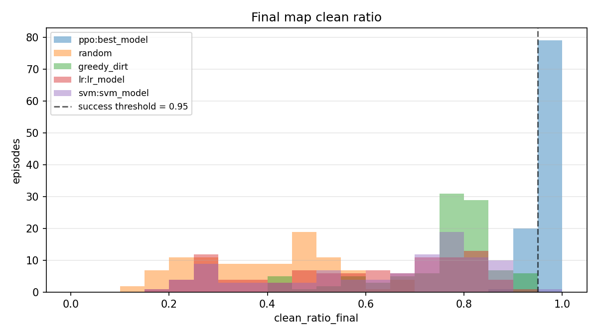
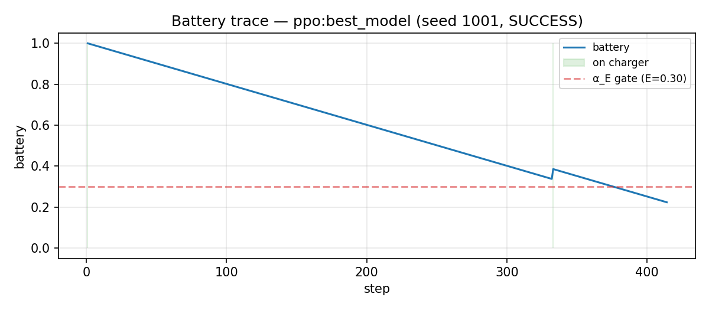

# Curiosity-Driven Vacuum Navigation

**PPO with a lightweight Gaussian belief module for cleaning, exploration, and battery-aware navigation.**

A machine-learning course project by **Yang Xi** and **Peng Chengyuan** · Group 10.

The final warm-started PPO + GP agent completes **91 of 100 evaluation episodes**, with **94.85% mean final clean ratio**, **88.74% coverage**, and **421.6 steps per episode**.

[Results](#experimental-results) · [GP mathematics](#the-gaussian-belief-module) · [Quick start](#quick-start) · [Code map](#code-map)

| PPO + GP — success | Dirt-greedy — battery depleted |
|:---:|:---:|
|  |  |

*Routes under the same evaluation seed (1001). Gray regions are obstacles; the yellow star marks the charger. PPO + GP reaches the target in 414 steps. The green marker is the first recorded post-action position.*

## Background

A robot vacuum must cover multiple rooms, clean changing dirt patterns, and keep enough battery to operate. This project models those decisions in a **20 × 20 grid** with two bedrooms, a living room, furniture, doorways, and a charger at `(18, 1)`.

- **Actions:** up, down, left, right; blocked moves incur a collision penalty.
- **Observations:** 57 values — a 5 × 5 obstacle patch, a noisy 5 × 5 dirt patch, and seven scalars for battery, charger displacement, position, and local GP mean/standard deviation.
- **Dynamics:** furniture-centered dirt hotspots, sinusoidal drift, and a 500-step regeneration cooldown after cleaning.
- **Objective:** reach a clean ratio of at least 95% before battery depletion or the 1,500-step limit. Clean ratio measures remaining dirt mass relative to the baseline map; coverage measures the fraction of passable cells visited.

## Main implementation

**PPO** learns the movement policy. A separate **Gaussian belief module** tracks dirt estimates and uncertainty online, supplies two observation features, and shapes an intrinsic exploration reward. **Behavior-cloning baselines** fit logistic regression and a linear SVM to demonstrations from a BFS teacher. Random movement and a local dirt-greedy heuristic provide additional comparisons.



## The Gaussian belief module

The GP add-on is implemented as an **independent Bayesian grid with Gaussian spatial smoothing**. Its configuration is fixed, while its belief maps update online. PPO learns from these maps through features and rewards.

### 1. Per-cell Gaussian beliefs

Each passable cell stores a Gaussian dirt estimate:

$$
d_{r,c}\sim\mathcal{N}(\mu_{r,c},v_{r,c}),\qquad
\mu_{r,c}^{(0)}=0.5,\quad v_{r,c}^{(0)}=1.
$$

During training, the callback reads the dirt collected at the current cell, adds simulated Gaussian sensor noise with standard deviation 0.15, and clips the measurement to $[0,1]$. For measurement $y$, the update is:

$$
K=\frac{v}{v+\sigma_n^2},\qquad
\mu\leftarrow\mu+K(y-\mu),\qquad
v\leftarrow v(1-K),\qquad \sigma_n^2=0.0225.
$$

A more uncertain prior gives the new measurement greater weight. The module returns the mean map and standard-deviation map, $\sigma=\sqrt{v}$. See [`gp/grid_gp.py`](gp/grid_gp.py).

### 2. Spatial information sharing

After the cell-wise updates, a Gaussian kernel $G_\ell$ smooths the mean using inverse variance as the weight:

$$
q_{r,c}=\frac{1}{v_{r,c}+\epsilon},\qquad
\widetilde{\mu}=\frac{G_\ell*(\mu q)}{G_\ell*q+\epsilon}.
$$

Blocked cells have zero weight. The smoothed mean is applied to passable cells with $v>0.5v^{(0)}$; their variance is multiplied by 0.85. Variance is then floored at $\sigma_n^2$ and means are clipped to $[0,1]$. This combines precise local updates with inexpensive spatial sharing.

### 3. Connecting uncertainty to PPO

The environment inserts the **current cell's** $(\mu,\sigma)$ into the last two observation features. It also adds:

$$
R_{\mathrm{int}}=\beta_n\,\alpha_E(E)\,\sigma(r,c),\qquad
\alpha_E(E)=\max\left(0,\frac{E-0.30}{0.70}\right),
$$

$$
\beta_n=\max(0.05,\;0.50-0.0005n).
$$

Uncertain locations receive a larger exploration bonus when energy is available. Below 30% battery, the bonus is zero. Its coefficient decreases with episode count so the policy gradually places less weight on exploration. The external reward combines dirt removal with diminishing revisit rewards, charging, movement/collision penalties, and terminal success/depletion rewards.

Each of the eight training environments maintains its own belief object. Observations are buffered every step; maps are updated and injected every five steps. Internal GP state resets at episode end. The standalone evaluation adapter updates every step by default. See [`gp/training_callback.py`](gp/training_callback.py) and [`environment.py`](environment.py).

| GP setting | Value |
|---|---:|
| Prior mean / variance | 0.5 / 1.0 |
| Measurement noise SD / variance | 0.15 / 0.0225 |
| Gaussian smoothing length scale | 1.5 cells |
| High-uncertainty threshold | Variance > 0.5 × prior variance |
| Spatial variance multiplier | 0.85 |
| Variance floor | 0.0225 |
| Training update interval | 5 steps per environment |
| Intrinsic coefficient | 0.50 → 0.05 |
| Battery gate | Zero at battery ≤ 30% |

## Experimental results

**Protocol:** 100 episodes per policy, seeds 1000–1099, fixed spawn `(17, 1)`, deterministic learned policies, the same room layout, and a 1,500-step limit. The table combines the saved PPO evaluations and the final baseline comparison. All figures below are original saved experiment outputs.

| Policy | Final clean ratio ↑ | Coverage ↑ | Success ↑ | Mean steps |
|---|---:|---:|---:|---:|
| **PPO + GP, warm start (v5)** | **94.85%** | **88.74%** | **91%** | **421.6** |
| PPO, fixed GP stub (v4) | 93.92% | 87.92% | 70% | 439.1 |
| PPO + GP, from scratch (v4) | 91.25% | 91.20% | 62% | 906.5 |
| Dirt-greedy heuristic | 75.73% | 74.93% | 0% | 544.6 |
| BC — linear SVM | 63.21% | 64.70% | 1% | 499.3 |
| BC — logistic regression | 58.29% | 60.79% | 0% | 500.3 |
| Random | 39.41% | 43.98% | 0% | 629.9 |

The warm-started agent achieves the highest completion rate among these runs. It starts from the best pure-PPO checkpoint and receives an additional 500,000 training steps with the GP enabled. The two v4 runs each use a 1,000,000-step training budget. The PPO stub keeps $\mu=0.5$ and $\sigma=1$, so its intrinsic bonus has no spatial variation. These are results for the saved runs on this map; the warm-start comparison includes both GP integration and additional training.

The BC models use **44,010 teacher state–action pairs**, split 80/20. Validation action accuracy is **89.48% for LR** and **88.85% for SVM**; their closed-loop success rates show that matching individual teacher actions does not guarantee successful full episodes.

### Visit heatmaps: exploration versus repeated local movement

Mean cell-visit counts over 100 episodes. PPO + GP distributes visits across the rooms, while BC-SVM concentrates repeated visits in a few locations. **Color scales differ between panels**; compare spatial patterns together with each color bar.

| PPO + GP | BC — linear SVM |
|:---:|:---:|
|  |  |

### GP posterior residual heatmap

This red-and-black map shows **mean absolute posterior error**, averaged across the final states of the 100 PPO + GP episodes:

$$
\operatorname{MAE}(r,c)=\frac{1}{100}\sum_{e=1}^{100}
\left|\mu^{\mathrm{final}}_e(r,c)-d^{\mathrm{final}}_e(r,c)\right|.
$$

Dark cells indicate smaller residuals; red/yellow cells indicate larger residuals. White regions are masked obstacles. The GP parameter values are listed above.

<p align="center">
  
</p>

<details>
<summary>More evaluation plots and raw results</summary>

| Episode outcomes | Final clean-ratio distributions |
|:---:|:---:|
|  |  |



- [Final five-policy comparison](runs/final_showdown/eval/bc_baseline/report.md) · [Episode CSV](runs/final_showdown/eval/bc_baseline/episodes.csv)
- [Pure PPO v4](runs/ppo_v4/eval/v4_baseline_1500steps/report.md)
- [PPO + GP v4, from scratch](runs/ppo_gp_v4/eval/v4_gp_pure_vs_greedy/report.md)
- [PPO + GP v5, warm start](runs/ppo_gp_v5/eval/v5_gp_pure_vs_greedy/report.md)
- [BC training metrics](runs/bc/train_report.json)

</details>

## Quick start

Use **Python 3.12**, matching the saved PPO checkpoints. The requirements pin the recorded NumPy, Gymnasium, Stable-Baselines3, and PyTorch versions. The repository includes the three best PPO checkpoints, BC classifiers, run configurations, training CSVs, and evaluation summaries.

```bash
git clone https://github.com/Phil-1030/gp-ppo-vacuum-navigation.git
cd gp-ppo-vacuum-navigation
python3.12 -m venv .venv
source .venv/bin/activate
python -m pip install -r requirements.txt
```

On Windows, activate with `.venv\Scripts\activate`.

**Evaluate the final saved model against all four baselines:**

```bash
python evaluate.py --suite bc_baseline \
  --model runs/ppo_gp_v5/best_model.zip \
  --run-root runs/reproduced \
  --experiment-name final_comparison \
  --gp-adapter live:eval.gp_adapter:LiveGPAdapter
```

Outputs include episode CSVs, aggregate JSON, a Markdown report, routes, visit heatmaps, battery traces, and GP diagnostics.

<details>
<summary>Train agents and regenerate visualizations</summary>

```bash
# Stage 1: pure PPO
python train_ppo.py --run-name ppo_baseline --total-timesteps 1000000

# Stage 2: enable GP and fine-tune the best PPO checkpoint
python train_ppo.py --gp --run-name ppo_gp_warmstart \
  --resume runs/ppo_baseline/best_model.zip --total-timesteps 500000

# Alternative: PPO + GP from scratch
python train_ppo.py --gp --run-name ppo_gp_scratch --total-timesteps 1000000

# Collect BFS demonstrations and train the two BC classifiers
python train_bc.py --n-episodes 200 --output-dir runs/bc_new

# Training curves and the static floor plan
python plot_training.py runs/ppo_gp_warmstart
python plot_layout.py
```

Use new run names to retain the bundled experiment evidence. The demonstration dataset and intermediate training checkpoints are regenerated by the training scripts.

</details>

## Code map

| File / directory | Responsibility |
|---|---|
| [`environment.py`](environment.py) | Room topology, dirt dynamics, observations, battery, rewards, termination |
| [`train_ppo.py`](train_ppo.py), [`ppo_config.py`](ppo_config.py) | PPO training, checkpoints, evaluation callbacks, hyperparameters |
| [`gp/`](gp/) | Bayesian grid, Gaussian smoothing, configuration, training integration |
| [`train_bc.py`](train_bc.py) | Teacher demonstration collection and LR/SVM training |
| [`eval/`](eval/) | Policies, GP adapters, episode runners, metrics, statistics, plots |
| [`evaluate.py`](evaluate.py) | Evaluation CLI and report generation |
| [`runs/`](runs/) | Saved models, configurations, training logs, and evaluation evidence |
| [`docs/assets/`](docs/assets/) | Selected original experiment figures used in this README |

